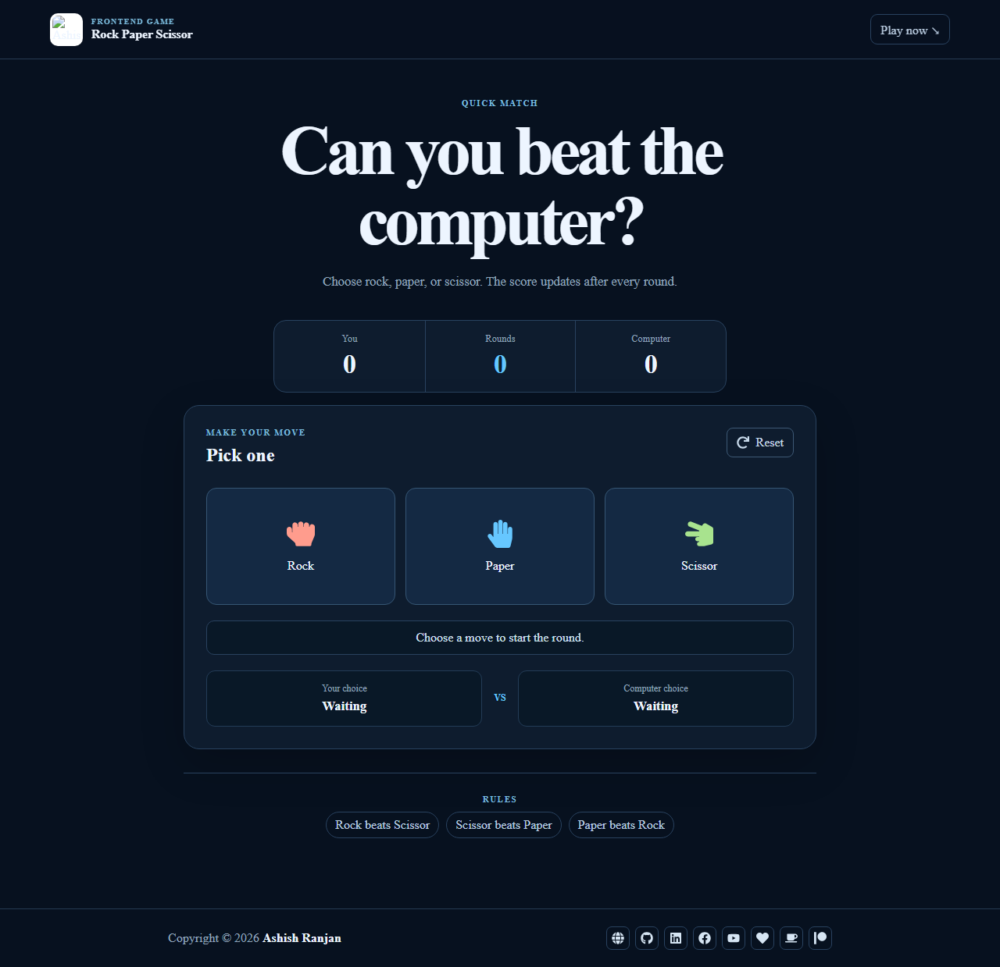

# Rock Paper Scissors

A responsive React game where you play rock, paper, scissors against a randomly choosing computer opponent.



## Features

- Rock, paper, and scissors choices with icon-based controls.
- Player and computer scores with round count.
- Live round result and current choices.
- Reset button and concise rules panel.
- Small-screen menu and floating back-to-top control.
- Responsive fixed header and icon-only footer links.

## Tech stack

React, Vite, Sass modules, and React Icons.

## Run locally

Use Node.js 20.19 or newer, then run:

```bash
npm install
npm run dev
```

Run `npm run lint` and `npm run build` to check the project. Deploy the `dist` folder to GitHub Pages with `npm run deploy`.

## Live

[Open the live game](https://a2rp.github.io/rock-paper-scissor/)

## Links

- Portfolio: [https://www.ashishranjan.net](https://www.ashishranjan.net)
- GitHub: [https://github.com/a2rp](https://github.com/a2rp)
- CodePen: [https://codepen.io/ash1198](https://codepen.io/ash1198)
- LinkedIn: [https://www.linkedin.com/in/aashishranjan](https://www.linkedin.com/in/aashishranjan)
- Facebook: [https://www.facebook.com/theash.ashish/](https://www.facebook.com/theash.ashish/)
- YouTube: [https://www.youtube.com/@ashishranjan-ashz?sub_confirmation=1](https://www.youtube.com/@ashishranjan-ashz?sub_confirmation=1)
- Email: [ash.ranjan09@gmail.com](mailto:ash.ranjan09@gmail.com)

## Support

- Support: [https://a2rp-donation-page.netlify.app/](https://a2rp-donation-page.netlify.app/)
- Buy Me a Coffee: [https://buymeacoffee.com/a2rp](https://buymeacoffee.com/a2rp)
- Patreon: [https://patreon.com/a2rp](https://patreon.com/a2rp)
